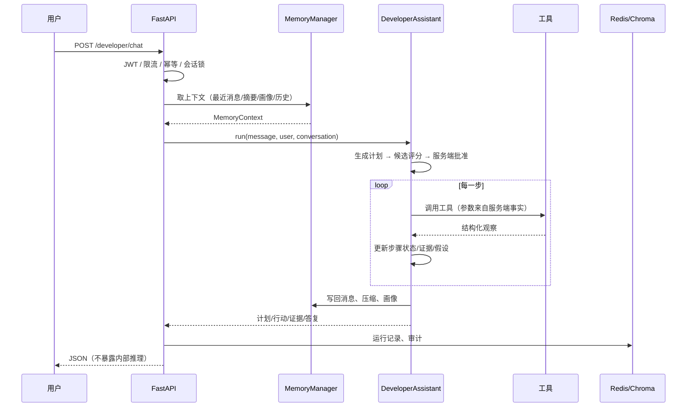
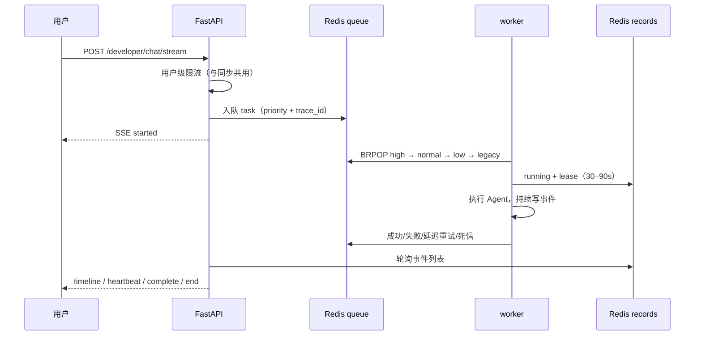

# DevTrace 架构说明

> 5 分钟项目架构导读。详细模块对照见 [智能体核心模块说明](../backend/developer/智能体核心模块说明.md)。

## 1. 系统总览

```mermaid
flowchart LR
    UIFVue 3 对话页] -->|JWT + REST / SSE| APIFFastAPI API]
    API --> AUTHF认证 / RBAC<br/>workspace 解析]
    API --> CHATF同步 chat]
    API --> STREAMF流式 chat]
    API --> AUDITF审计 Redis Stream]
    API --> MEMFMemoryManager]
    API --> QUEUEFRedis 任务队列]
    QUEUE --> WORKERF独立 worker]
    WORKER --> AGENTFDeveloperAssistant]
    CHAT --> AGENT
    STREAM --> QUEUE
    AGENT --> PLANFplanner<br/>候选计划评分]
    AGENT --> LOCALF本地工具管理器]
    AGENT --> MCPFMCP client]
    MCP --> MCPSFMCP server<br/>8 个只读工具]
    LOCAL --> SANDBOXF模拟开发者平台<br/>FastAPI + SQLite]
    MCPS --> SANDBOX
    MEM --> REDISF(Redis<br/>工作记忆/摘要/计划)]
    MEM --> CHROMAF(ChromaDB<br/>情景记忆/画像/文档)]
    API --> REDIS
    WORKER --> REDIS
```

**关键点**

- API 只做认证、限流、入队/中继；长任务由 worker 执行，API 重启不丢排队任务。
- Agent 的每一步都受服务端计划、工具白名单、证据依赖和参数来源约束；模型不直接接触真实平台凭据。
- 本地工具与 MCP 工具共用 base 名规则；MCP 失败不会静默回退本地工具，避免“这次到底用了哪条传输”不可见。
- 审计是应用层只追加，Redis 不是 WORM；限流、会话锁、队列都依赖 Redis。

## 2. 一次同步诊断



## 3. 流式与队列



**可靠性设计**

- 任务带 `lease_id`/`lease_until`，运行中每 30s 续租；租约过期由其他 worker 用 `SET NX` 互斥回收。
- 失败走延迟 ZSET（1s/2s/4s，上限 30s），达到 `MAX_ATTEMPTS` 进死信；管理员可重放。
- 会话锁值保存 `task_id`，终态释放用 Lua `GET == task_id` 比较删除，避免晚到清理删掉新任务的锁。
- 维护循环的失败终态（重试耗尽/`interrupted`）也会 owner-aware 释放锁并写一条 `task.finished` 审计。

## 4. 记忆分层

```mermaid
flowchart TB
    WF工作记忆<br/>Redis List + TTL] --> CF压缩摘要<br/>Redis + TTL]
    C --> EF情景记忆<br/>Chroma episodic]
    W --> PF用户画像<br/>Chroma profile]
    E --> CTXFMemoryContext]
    C --> CTX
    P --> CTX
    W --> CTX
```

- 工作记忆/摘要按 `DEVTRACE_MEMORY_TTL_SECONDS` 过期；Chroma 情景/画像不过期，只能用 API 或保留 CLI 显式删除。
- 记忆导出/删除按 token 用户隔离；画像删除只删自己的。
- 真实模型摘要评测同时报告 strict 与 semantic，semantic 要求编号逐字、结论做否定保护；不把“关键词出现”当保留。

## 5. 安全边界

- JWT 只放 `sub/iat/exp/iss`；管理员角色由服务端 `DEVTRACE_ADMIN_USERS` 判定，不进 token。
- workspace 由服务端 users 配置解析，不写 JWT；run/task 跨 workspace 一律 404。
- 工具参数来自用户输入或已观察记录；工单必须用户显式授权；用户文本/工具观察中的指令标记为不可信数据。
- 审计 `detail` 白名单 + 密钥形态脱敏；不记录消息正文、工具结果、完整 Key。
- 依赖漏洞：ChromaDB 0.5.23 三条上游未修复，内网演示 + CI 审计门禁；详见 F依赖与安全评估](../backend/developer/依赖与安全评估_2026-10-18.md)。

## 6. 评测与证据

- 固定案例 30 条、holdout 40 条（作者手写，非第三方基准）、记忆任务 12 条、MCP 10 条、公开文档 28 条、错误手册 40 条。
- 真实模型全量 40 条 holdout：37/40；失败项保留并分类，不为了通过改断言。
- 所有评测 JSON 在 `backend/developer/`，CI 运行规则模式；真实模型评测按预算手动运行。
- 最终验收与限制清单：[FINAL_REVIEW](FINAL_REVIEW.md)。

## 7. 生产化差距

- 身份服务/OIDC、TLS、密钥轮换、RBAC 多角色、workspace 成员与物理分区；
- Redis/Chroma 高可用、备份/故障切换、容量压测；
- 审计 WORM/导出、网关级限流、多 provider 适配、外部 MCP 信任模型；
- 多 Agent/并行计划/ToT 未实现，当前是受约束单 Agent。
